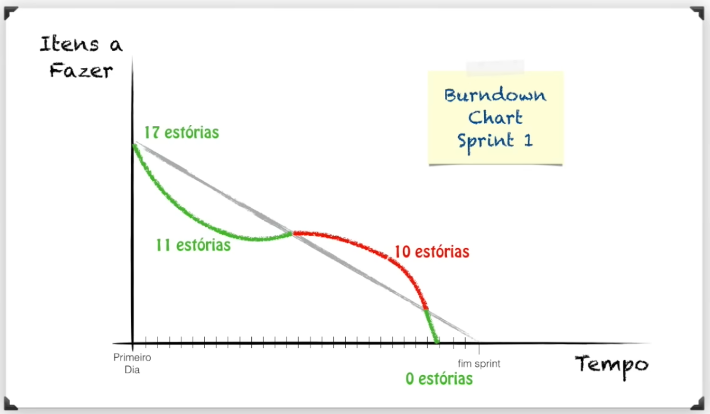
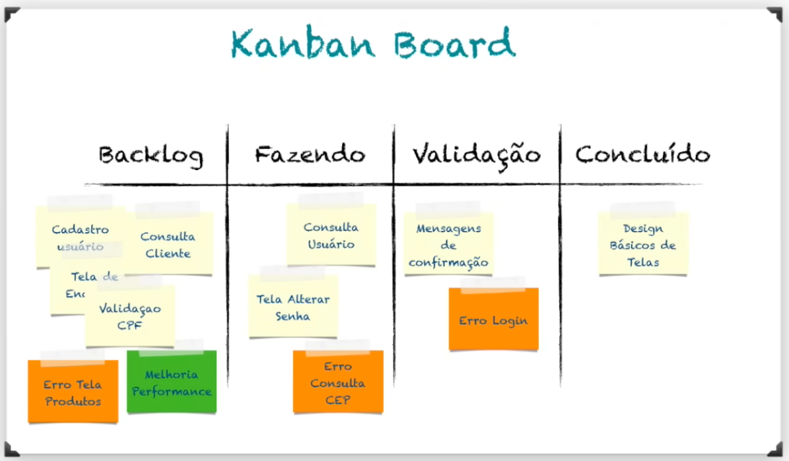
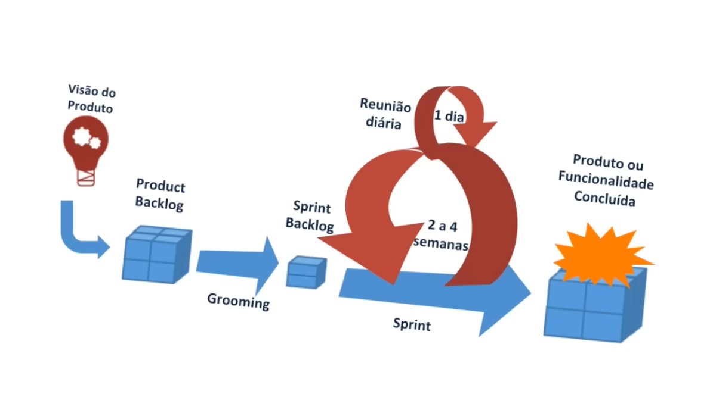

# Scrum
- Framework pra gerenciar projetos completos
- Jira, ClickUp, Trello
- Quanto mais se tem domínio sobre os requisitos e sobre a tecnologia, mais fácil se torna o gerenciamento do projeto. Podendo usar a metodologia de cascata (uma task se inicia após o fim da outra). Previsível x Caótico x Anarquia

## 3 pilares
1. Transparência dos processos, requisitos de entrega e status
2. Inspeção constante de tudo o que está sendo feito
3. Adaptação, tanto do processo, quanto do produto às mudanças

## Práticas fundamentais
- Papéis
  - Scrum Master
    - Responsável por ajudar todos os envolvidos a entender os valores e práticas do Scrum.
    - Agir como um coach
    - Facilitador: não é chefe de ninguém
  - Product Owner
    - Líder sobre o produto, responsável por decidir quais recursos serão construídos e a ordem deles.
    - Passar a visão clara do objetivo
  - Dev Team
    - Time de desenvolvimento. A equipe se auto-organiza pra cumprir a meta estabelecida pelo PO
- Eventos
  - Sprint planning
    - Reunião de planejamento das sprints, onde é criado o backlog
    - Definido quantas funcionalidades podem ser construídas no tempo de sprint
  - Daily Scrum
    - Reunião diária para acompanhamento das entregas
    - 3 perguntas básicas: o que eu fiz ontem? o que vou fazer hoje? tem impedimentos?
  - Retrospectiva Sprint
- Artefatos
  - Product Backlog
    - Funcionalidades do produto ordenadas por prioridade
  - Sprint backlog
  - Incremento/entrega

## Dinâmica do Scrum
- Visão do produto
  - O PO fornece essa visão. Deve descrever o que quer e onde quer chegar.
  - Desmembra a visão em todas as funcionalidades necessárias. Isso é o product backlog.

## Burndown chart
- Gráfico que relaciona itens a fazer com o tempo

## Kanban board
- Organização do fluxo de trabalho em cards

## Retro x Review
### Sprint Review
- Apresentação do que foi feito no sprint
- Aqui que surgem mudanças, verificar necessidades de adaptação do produto

### Retrospectiva
- Verificar necessidades de adaptação no processo
- O que foi feito que foi positivo e negativo

### Resumo das Diferenças
| Característica | Sprint Review | Sprint Retrospective |
|---|---|---|
| **Principal foco** | O produto / O que foi entregue | O processo / Como o time trabalhou |
| **Quem participa** | Time Scrum + Stakeholders / Clientes | Apenas o Time Scrum (sem convidados externos) |
| **Pergunta central** | "O que foi construído atende ao que foi pedido?" | "Como podemos melhorar nossa forma de trabalhar?" |

